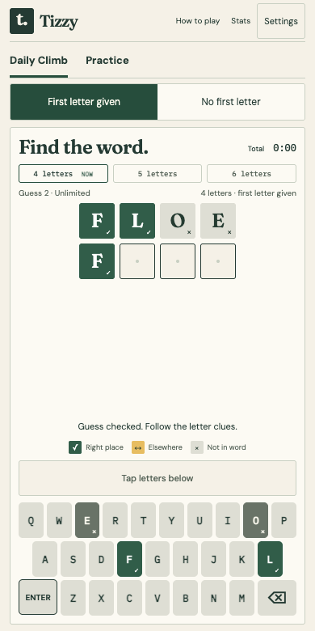
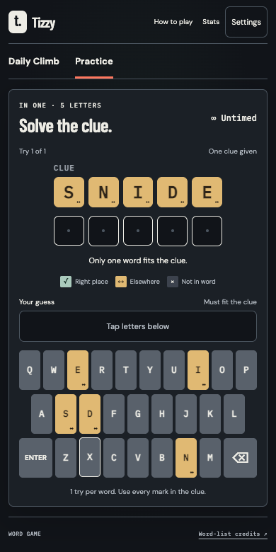
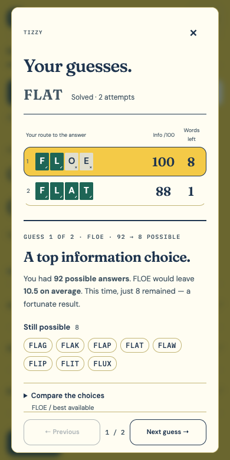

# Tizzy

A word game for a quick puzzle, a daily race, or one more try. Find words from their letter clues, climb from four letters to six, and see how much each guess taught you.

**[Play Tizzy →](https://tizzy.tweakyllama.uk)** · [Game modes](#game-modes) · [Run locally](#run-locally) · [Documentation](#documentation)

<table>
  <tr>
    <th>Daily Climb</th>
    <th>In one</th>
    <th>Guess analysis</th>
  </tr>
  <tr>
    <td></td>
    <td></td>
    <td></td>
  </tr>
</table>

Built for phones and physical keyboards, with three themes: **Letterpress**, **Afterhours** and **Word Club**. Change the appearance without resetting your game.

## Game modes

| Mode | The challenge | Guesses | Clock |
| --- | --- | --- | --- |
| **Daily Climb** | The day's shared 4 → 5 → 6 course | Unlimited | Race on elapsed time |
| **Practice** | A fresh 4-, 5- or 6-letter word | Five per word | Untimed |
| **Climb** | Solve four letters, then five, then six | Five per word | Untimed |
| **Quickfire** | A 4- or 5-letter word under pressure | Five per word | 10 seconds per guess |
| **Sprint** | Complete a 4 → 5 → 6 climb | Unlimited | 90 seconds overall |
| **In one** | Use a marked word to find the only answer that fits | One | Untimed |

Daily Climb, Practice and regular Climb offer **First letter given** and **No first letter** variants. In one supplies a clue instead: a known word that breaks the clue uses your only try, while an unknown word does not.

Choose a practice preset in **Settings**. Preview its rules, then **Apply now**, or **Save for next round** to finish your current game first. During timed play, clocks keep running across tab switches and while dialogs are open. Sprint pauses after a solve or **Give up**; continuing resumes the remaining time. Giving up reveals the answer and lets you retry at the same length.

## A daily race, at your pace

Everyone gets the same daily course for their chosen hint variant. The two variants have different words and separate records, with new courses arriving at **00:00 UTC**.

- **No guess limit or time limit.** Finish all three words and compare your total time and word splits.
- **Pause between words.** Each word's clock runs until solved, including across tabs and reloads. The next clock starts when you reveal the next word.
- **Pick up where you left off.** Progress saves after each guess. You can finish an older saved climb on its original puzzle date.
- **Share without spoilers.** Copy your result with its time, splits and hint variant.

Daily Stats tracks personal bests and streaks. Progress and results live in your browser; there is no shared leaderboard.

## Learn from each guess

After a word ends, **Analyse guesses** walks through your choices: expected information, remaining possible answers, solve chance and more informative alternatives. In one explains how its clue narrows the answer down.

Practice analysis is available until you move to the next word. Completed daily climbs retain their guesses for later review.

**Stats** keeps finished practice words by mode and variant, with totals, streaks, guess distributions and recent results. In one uses solve-time charts. All records stay on your device.

## Run locally

Built with **React**, **TypeScript** and **Vite**. Requires Node.js **22.12+ within 22.x**, **24.x**, or **26+**, and npm.

```sh
npm ci
npm run dev
```

Open the local URL printed by Vite.

### Tunnel access

For a development tunnel, add its allowed hosts to an untracked `.env` file:

```dotenv
DEV_ALLOWED_HOSTS=.ngrok-free.app
```

Use commas for multiple hosts. If you use mise, run `mise trust` once; `mise.toml` loads the file.

## Development commands

| Command | Purpose |
| --- | --- |
| `npm test` | Run unit tests for game rules, clocks, presets, storage, clues and word data |
| `npm run build` | Check TypeScript and create the production build in `dist/` |
| `npx playwright install chromium` | Install the browser for end-to-end tests, once per machine |
| `npm run test:e2e` | Build and test gameplay, dialogs, timers and mobile layouts against development and production preview |
| `npm run words:build` | Regenerate answer, guess and clue lists from the pinned ESDB snapshots |

Static word data lives in `public/words/` and is copied into production builds. The daily course uses an immutable, versioned schedule in [`src/daily-v1.json`](src/daily-v1.json). **Do not replace that schedule when rebuilding word lists** or change existing preset keys: they identify saved history.

UI studies are available at `/prototypes/index.html` on the dev server ([source](public/prototypes/index.html)). These are visual explorations; the playable app lives in `src/`.

## Deployment

Tizzy is served as static assets by a Cloudflare Worker at **[tizzy.tweakyllama.uk](https://tizzy.tweakyllama.uk)**. Worker and domain settings are in [`wrangler.jsonc`](wrangler.jsonc).

Install the pinned Wrangler CLI with mise and authenticate once:

```sh
mise install
wrangler login
```

Then build and deploy:

```sh
npm run deploy
```

## Documentation

- [Game rules](docs/design.md) — feedback, guesses, progression and clocks
- [UI specification](docs/ui.md) — layouts, controls and result screens
- [Codebase design](docs/codebase.md) — modules and responsibilities
- [Word lists](docs/wordlist.md) — data sources and generation
- [Implementation plan](docs/plan.md) — feature requirements and implementation notes
- [Prototype notes](docs/ui-prototypes.md) — earlier interface explorations

## Credits

See the [word-list copyright and licences](public/words/COPYRIGHT.txt) and [typeface credits](public/fonts/README.txt).
